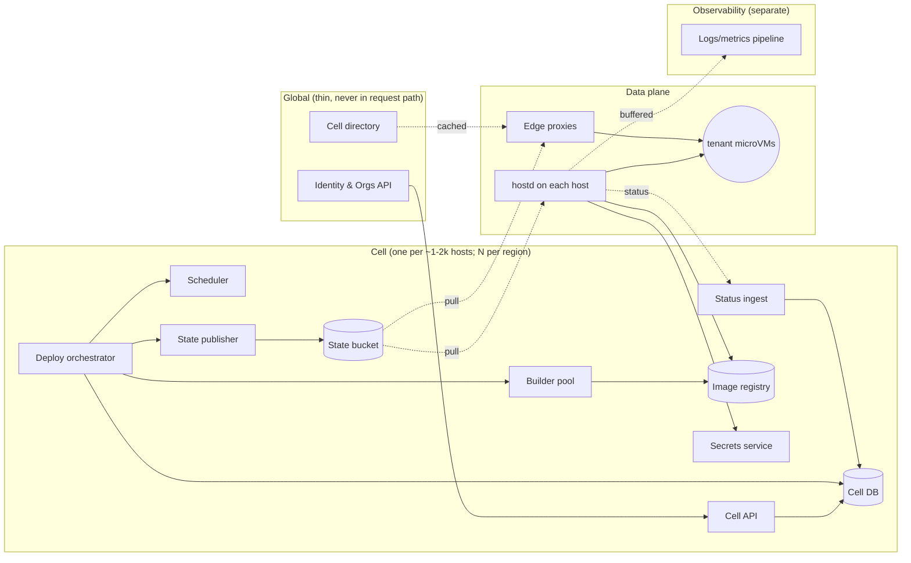
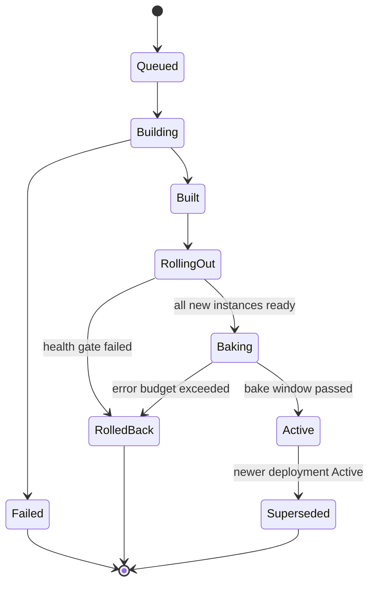

# ccloud core architecture

Status: draft for review. This defines the core contracts **before** we build them. The single-host spike (`crates/hostd`) is evidence for the runtime choices. It is not the final shape.

## 1. Goals and non-goals

**Goals**
1. **Multi-tenant by default.** Tenants are hostile to each other. No shared kernel, network, disk, or secret between tenants.
2. **Independent components.** Every component keeps doing its job when any other component is down. It degrades the *rate of change*, never the *running state*.
3. **Zero-downtime releases.** Rolling/blue-green deploys with health gates, connection draining, and instant rollback.
4. **Small blast radius.** A bad host, cell, rollout, or tenant affects only itself.

**Non-goals (for the core)**: GPUs, managed databases, multi-region active/active for a single service, Kubernetes compatibility.

## 2. Lessons this design answers (from Railway's public incidents)

| Railway incident | Rule here |
|---|---|
| May 2026: GCP account suspended, edge routes expired, everything went down | Edges and hosts keep the **last-known-good** state forever. Nothing expires because the control plane is gone. |
| Sep 2026: a routing service rolled out ahead of its schema, and "lookup error" was treated as "domain doesn't exist" | Errors are never interpreted as deletes. Deletes are explicit tombstones. Every component accepts schema N-1..N+1. |
| Oct 2026: a build/CI compromise led to customer secret decryption | Only `hostd` can decrypt, and only for VMs it is about to boot. Builders and CI have no decrypt rights. |
| Nov 2025: deploy queues stalled under load | Per-tenant concurrency limits and fair queueing; per-cell queues; shed load per tenant, not globally. |
| Jul 2026: network latched onto a bad path after recovery | Data-plane state is periodically re-derived from desired state, not just edge-triggered. |

## 3. Components and planes



There are four planes. Arrows are the **only** allowed dependencies.

| Plane | Components | Lives where | If it's down… |
|---|---|---|---|
| Global | Identity/Orgs API, cell directory | 2+ regions, small | No signups or new projects. Everything existing keeps running and deploying. |
| Cell control plane | Cell API, DB, orchestrator, scheduler, state publisher, builder pool, secrets, status ingest | Per cell, own failure domain | No new deploys in that cell. Running services, scaling-from-zero, restarts, and routing all continue. |
| Data plane | `hostd`, edge proxy, mesh, volumes | Every host / edge POP | Only the instances on that host/POP. Others are unaffected. |
| Observability | Log/metric shippers + storage | Separate cluster | Hosts buffer to local disk (bounded). Never backpressures workloads. |

### 3.1 Component contracts

Components talk through **three kinds of interfaces only**.

1. **Desired-state documents** (control plane → data plane). These are immutable, versioned, and signed JSON in an object bucket. Consumers **pull**. They are never pushed.
2. **Status reports** (data plane → control plane). Append-only and best-effort: "here is what I observe." Losing them delays decisions but never changes running state.
3. **Content-addressed artifacts.** OCI images by digest from the registry. Rootfs and snapshot blobs are addressed by hash.

There are no synchronous RPCs on the request path. There are no RPCs from the data plane that must succeed for a workload to keep running.

| Component | Reads | Writes | Owns |
|---|---|---|---|
| Cell API | DB | DB | Tenant-facing resources (projects, services, envs, deployments), authz |
| Orchestrator | DB, status | DB, workflows | Deployment state machines (durable workflows) |
| Scheduler | Host inventory + capacity | Placement decisions (DB) | Where instances go; pure function, stateless |
| State publisher | DB | State bucket | Compiles DB → per-host and per-edge documents; signs them |
| Builder pool | Source / Dockerfile | Registry | Image builds in throwaway microVMs; no secrets beyond build args |
| Secrets service | Wrapped DEKs | — | KEK custody, unwraps DEKs **only** for authenticated `hostd` with an assignment for that env |
| hostd | Host doc, registry, secrets | Status, logs | Everything on one host: VMs, TAPs, nftables, health checks, restart, sleep/wake |
| Edge proxy | Edge doc, cell directory | Access logs | TLS termination, routing, active + passive health, draining |
| Status ingest | Host/edge reports | DB | Observed state |

### 3.2 Desired-state documents

There are two kinds, both written by the publisher:

```jsonc
// hosts/<host-id>/v<version>.json   (+ hosts/<host-id>/latest pointer)
{
  "schema": 1,
  "version": 18342,                 // monotonic per host; older is ignored
  "cell": "us-east-1a",
  "instances": [{
    "id": "ins_01J…",
    "tenant": "org_…", "project": "prj_…", "env": "env_…", "service": "svc_…",
    "deployment": "dep_…",
    "image": "registry.cell/…@sha256:…",
    "resources": {"vcpus": 1, "memory_mib": 512, "disk_mib": 2048, "net_mbps": 200},
    "secrets_ref": {"env": "env_…", "version": 7},
    "ports": [{"name": "http", "port": 3000}],
    "health": { /* see §5.2 */ },
    "desired": "running",           // running | sleeping | stopped
    "net": {"ipv6": "fdcc:…::12", "env_network": "net_…"},
    "volumes": [{"id": "vol_…", "mount": "/data"}]
  }],
  "tombstones": ["ins_…"]           // only way to remove an instance
}
```

```jsonc
// edges/<cell>/v<version>.json
{
  "schema": 1, "version": 99120,
  "routes": [{
    "host": "api.acme.com", "service": "svc_…",
    "backends": [
      {"instance": "ins_A", "addr": "[fdcc:…::12]:3000", "weight": 100, "state": "active"},
      {"instance": "ins_B", "addr": "[fdcc:…::19]:3000", "weight": 0,   "state": "draining"}
    ],
    "sleep": {"enabled": true, "host": "h-123"}   // where to wake it
  }],
  "tombstones": ["old.acme.com"]
}
```

**Consumer rules (identical in `hostd` and the edge):**
- Validate the signature, schema, and `version > current`. If any check fails, **keep the current doc** and alert.
- Persist the last applied doc to local disk. On restart, apply it **before** contacting anything.
- An instance/route disappears only via a `tombstone`. A missing entry in a partial or broken doc is ignored.
- A doc that would remove more than X% of instances/routes at once is held for a human. This is a "big red button" guard against publisher bugs.
- Accept `schema` N-1, N, N+1, and ignore unknown fields. Producers are upgraded **after** all consumers.

## 4. Multi-tenancy

### 4.1 Resource model

```
Org (tenant, billing boundary)
└── Project
    └── Environment (production, staging, pr-123 …)   ← network + secrets boundary
        └── Service (web, worker, api …)
            └── Deployment (immutable: image digest + config + secrets version + resources)
                └── Instance (one microVM)
```

- Every DB row carries `org_id`. Every API query is scoped by it at the data-access layer, not in handlers.
- A **Deployment is immutable**. Changing anything (code, env var, CPU) creates a new deployment. This is what makes rollback trivial: roll back = redeploy an old deployment ID.

### 4.2 Isolation layers

| Layer | Mechanism |
|---|---|
| Compute | One microVM per instance. Firecracker under `jailer`: chroot, unique UID/GID per VM, seccomp, cgroups v2 (cpu.max, memory.max, io.max), no host devices. |
| Network | Each environment gets its own private network. `hostd` enforces default-deny between environments with nftables/eBPF on the TAP. Tenants can never reach host, metadata, or control-plane IPs. Egress is NAT'd and rate-limited per VM. |
| Storage | Volume = one ZFS dataset with per-tenant encryption keys, a quota, and an IO limit. Rootfs is per instance and discarded on redeploy. |
| Secrets | Envelope encryption: a per-environment DEK, wrapped by a cell KEK. Only `hostd` can request an unwrap, and only for envs it currently runs. Plaintext lives only in VM memory, delivered over vsock at boot. It is never written to disk and never sent to builders. |
| Builds | Each build runs in its own throwaway microVM on a **separate host pool**. Builders get registry push credentials scoped to one repo and nothing else. |
| Control plane | Per-tenant rate limits on API calls, deploys, and builds. Fair queueing in the orchestrator (one tenant can't fill the queue). |
| Edge | Per-tenant request rate limits and connection caps. Certificates are isolated per tenant hostname. |

### 4.3 Noisy-neighbor limits
- CPU: `cpu.max` quotas plus vCPU count. Hosts are overcommitted for CPU only, never memory.
- Memory: hard limits; balloon device for reclaim later.
- Disk/IO: `io.max` per VM, quota per dataset.
- Network: per-TAP `tc` shaping, plus a per-tenant conntrack limit.
- Deploy/build queues: per-tenant max concurrent workflows.

## 5. Releases: rollout, health, swap, rollback

### 5.1 Deployment and instance state machines

```mermaid
stateDiagram-v2
  [*] --> Pending
  Pending --> Preparing : image pulled + rootfs built
  Preparing --> Booting
  Booting --> Starting : VM up
  Starting --> Ready : startup + readiness probes pass
  Starting --> CrashLoop : probe timeout / exits
  Ready --> Unready : readiness fails
  Unready --> Ready
  Ready --> Restarting : liveness fails / exits
  Restarting --> Starting
  Ready --> Sleeping : idle (scale-to-zero)
  Sleeping --> Ready : request / wake
  Ready --> Draining : superseded
  Draining --> Stopped
  CrashLoop --> Stopped : backoff exhausted
```





`hostd` owns the instance state machine locally. The orchestrator only reads it via status reports.

### 5.2 Health checks

There are three probes, all configured per service and all run **by `hostd` from the host side** over the VM's TAP (no agent inside the guest is required):

| Probe | Default | Purpose | On failure |
|---|---|---|---|
| `startup` | HTTP `GET /` or TCP to the first port; every 250 ms, up to 5 min | "The app has booted." Gates the other two probes. | CrashLoop with backoff. The rollout gate fails. |
| `readiness` | Same target; every 2 s, fail after 3 | "Send me traffic." | Instance → `Unready`. Edge weight → 0 (via status → publisher, **and** locally at the edge, see below). |
| `liveness` | Optional; every 10 s, fail after 6 | "I'm wedged." | `hostd` restarts the VM locally (backoff: 1 s → 5 min). |

The edge also runs its own checks, independent of the control plane:
- **Passive:** a backend is ejected for 30 s after 5 consecutive connect errors or 5xx responses (outlier detection).
- **Active:** a light TCP check every 5 s on backends it routes to.
- **Never eject the last backend.** If every backend looks unhealthy, keep routing to all of them. Partial service beats a guaranteed 503.

This gives two independent paths to stop sending traffic to a bad instance: `hostd` → status → publisher (seconds), and the edge's local view (milliseconds). Neither path depends on the other.

### 5.3 Rolling deploy (stateless services, the default)

Parameters: `max_surge` (default 1 or 25%), `max_unavailable` (default 0), `drain_timeout` (default 30 s), `bake` (default 2 min).

```mermaid
sequenceDiagram
  participant U as User/API
  participant O as Orchestrator
  participant S as Scheduler
  participant P as Publisher
  participant H as hostd (new host)
  participant E as Edge
  participant Old as hostd (old host)

  U->>O: create Deployment D2 (image@sha, config, secrets v7)
  O->>S: place max_surge instances of D2
  S-->>O: host H, slot
  O->>P: host H doc += ins_B (desired running, not routed)
  P-->>H: v+1 (pulled)
  H->>H: pull image, build rootfs, unwrap secrets, boot VM
  H->>H: startup probe → readiness probe pass
  H-->>O: status ins_B Ready
  O->>P: edge doc: add ins_B weight 100, old ins_A state draining weight 0
  P-->>E: v+1 (pulled)
  E->>E: new requests → ins_B; existing conns on ins_A continue
  Note over E,Old: drain: wait for ins_A conns = 0 or drain_timeout
  O->>P: host Old doc: ins_A desired stopped
  Old->>Old: SIGTERM via guest init → grace → kill; keep snapshot during bake
  Note over O: repeat until all replicas swapped, then bake
  O->>O: bake window OK → D2 Active, D1 Superseded, tombstone D1
```

**Zero-downtime invariants** (the orchestrator checks them before every step):
1. Ready instances for the service ≥ `replicas - max_unavailable` (default: never fewer than before).
2. An old instance is put into `draining` **only after** a replacement is `Ready` **and** the edge has acked the route version that contains it. (Edges report their applied version in status.)
3. An instance is stopped only after its drain completes (connection count 0, or `drain_timeout`).
4. Surge capacity is reserved by the scheduler at deploy start. If it can't be reserved, the deploy waits. It never falls back to stop-then-start for stateless services.

**Graceful shutdown inside the VM.** `hostd` sends Ctrl-Alt-Del through Firecracker. `microinit` turns that into `SIGTERM` for the app and waits up to `grace` (default 10 s). Then it sends `SIGKILL` and powers off. Apps get the same contract as Docker/Kubernetes.

### 5.4 Other strategies

| Strategy | When | How |
|---|---|---|
| **Rolling** (default) | Stateless, ≥1 replica | §5.3 |
| **Blue/green** | Big changes, or the user wants an atomic cutover | Boot a full D2 fleet beside D1. Once all are Ready, flip the edge doc for the whole service in one version. Keep D1 warm (or snapshotted) through the bake, then drop it. |
| **Canary** | Opt-in | Like blue/green, but the edge weights step through 1% → 10% → 50% → 100%, with an error-rate gate at each step. |
| **Recreate** | Services with a single-attach volume | Stop D1, detach the volume, attach it to D2, start D2. **Has downtime** (seconds). The UI states this. Later: replicated volumes allow attach-before-detach. |

### 5.5 Rollback
- **Automatic** while rolling out or baking, if any of these happens:
  - startup probe fails on N instances
  - a new instance crash-loops
  - edge 5xx rate for D2 exceeds D1's baseline + threshold
- **Mechanism:** D1 instances are still running (rolling) or warm/snapshotted (blue/green during the bake). Rollback is one edge-doc version that sets weights back. That takes milliseconds after edges pull it, with no boot needed.
- **Manual rollback after the bake** = deploy an old Deployment ID. It's immutable, so it's exactly what ran before (same digest, config, and secrets version). It normally restores from a pre-warmed snapshot (§5.6), so it's fast.

### 5.6 Pre-warmed snapshots (fast scale-out and rollback)
After an instance first passes readiness, `hostd` can take a snapshot of it (pause, snapshot, resume; ~200 ms pause, measured in the spike). It uploads it as a content-addressed blob keyed by `deployment + resources`.
- New replicas of the same deployment **restore** instead of cold-booting: ~20 ms vs ~1.1 s in the spike.
- Scale-to-zero and wake reuse the same path.
- Caveat: everything in memory is cloned, including RNG seeds and unique IDs. We re-seed via the virtio-rng / vmgenid notification, and per-instance identity is injected after restore over vsock. This is opt-in per service until it's proven.

## 6. Networking

- **Public traffic:** client → anycast edge → (WireGuard mesh) → host → instance IPv6. The edge only needs the edge doc and the mesh.
- **Private traffic:** every service in an environment gets a stable name (`api.internal`) and a stable **service VIP**. `hostd` load-balances the VIP to the service's **Ready** instances with eBPF/nftables on every host. The backend set comes from the host doc, which includes the env's service backends. Swaps therefore update the VIP backends the same way the edge updates routes, with the same drain rules.
- **Mesh:** full-mesh WireGuard per cell. Keys are rotated by the publisher, and the old key stays valid for an overlap window. Paths are re-checked periodically, so a route that recovers doesn't stay pinned to a bad path.

## 7. Failure matrix

| Failure | Running services | Deploys | Scale-from-zero |
|---|---|---|---|
| Global plane down | ✅ | ✅ (existing projects) | ✅ |
| Cell DB / API / orchestrator down | ✅ | ❌ in that cell | ✅ (edge + hostd only) |
| Publisher or state bucket down | ✅ (last-known-good) | ❌ | ✅ |
| Registry down | ✅ | ❌ new images; restarts use cached rootfs | ✅ |
| Secrets service down | ✅ | ❌ | ✅ (hostd keeps the wrapped DEK + a sealed local cache for envs it runs) |
| Status ingest down | ✅ | ⚠️ paused (no Ready acks) | ✅ |
| Observability down | ✅ (hosts buffer) | ✅ | ✅ |
| Single host dies | ⚠️ its instances. The orchestrator reschedules after the host lease expires; multi-replica services keep serving. | ✅ | ✅ elsewhere |
| Edge POP dies | ✅ (anycast withdraws) | ✅ | ✅ |
| Bad publisher release | ✅ (signature/version/size guards hold the doc) | ⚠️ | ✅ |

## 8. Rolling out the platform itself

- Cells are upgraded **one at a time**, with a canary cell first. Hosts and edges within a cell are upgraded in waves (1% → 10% → 100%).
- DB migrations are expand → migrate → contract, with each phase a separate release. Code must work against both the old and new schema.
- Doc `schema` bumps follow the rule: **consumers first, producers later**.
- `hostd` upgrades don't restart VMs. Firecracker processes are re-parented and re-adopted from on-disk state on the new `hostd` start.

## 9. Build order (core first)

Each step is usable and testable on its own:

1. **Contracts:** Rust types + JSON schema for the host doc, edge doc, and status report; signing/verification; last-known-good persistence. (Shared crate `ccloud-proto`.)
2. **hostd reconciler v2:** consumes the host doc (from a local dir, then a bucket); instance state machine; startup/readiness/liveness probes; restart backoff; graceful stop via `microinit` SIGTERM; status reports to a file/HTTP sink; jailer + cgroups.
3. **Edge proxy v0:** consumes the edge doc; weighted backends; draining; passive + active health; never-eject-last; wake-on-request for sleeping services.
4. **Orchestrator v0:** single cell, Postgres + durable workflows. Rolling deploy with the §5.3 invariants, auto-rollback, and per-tenant queues. The scheduler is a bin-packer.
5. **Publisher:** DB → signed docs, with diff-size guards.
6. **Cell API + tenancy:** orgs/projects/envs/services/deployments; authz scoping; rate limits.
7. **Secrets service + builder pool.**
8. **Private networking:** env networks, VIPs, WireGuard mesh across hosts.
9. Volumes, observability, global plane, multi-cell.

Steps 1–3 can be built and tested on a single machine with hand-written docs. That proves zero-downtime swaps before any control plane exists.

## 10. Open decisions

1. **Workflow engine** for the orchestrator: Temporal (proven, heavy) vs a Postgres-backed state machine (simple, fewer moving parts). Leaning Postgres-backed for v0.
2. **State bucket:** S3-compatible (MinIO/R2/S3) vs serving docs from the publisher over HTTP with ETags. The bucket is simpler to keep up independently.
3. **Edge proxy:** build on Pingora vs a custom tokio/hyper proxy.
4. **Long-lived VMM:** stay on Firecracker for everything vs Cloud Hypervisor for long-lived services (hot-resize).
5. **Default rollout:** rolling vs blue/green as the default for single-replica services. Blue/green costs 2× memory during deploys.
